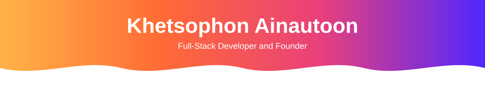

  
  
  

Hi there 👋 — I'm **Khetsophon (เขต)**, Full-Stack Developer & Founder building edge-first web platforms from Bangkok.

*นักศึกษาวิทยาการคอมพิวเตอร์ ม.ศรีปทุม — สร้างเว็บแบบ edge-first จากกรุงเทพฯ*

- 🎓 Third-year Computer Science student at Sripatum University (GPAX 3.90), expected 2028
- 🚀 Founder — Stealth Startup (in development)
- 💻 Freelance developer — shipped production systems for paying clients
- 🎯 Open to SWE internships (2027 cycle) & freelance projects
- 🌐 Portfolio: https://portfolio.hazeco-d2a.workers.dev/
- 📄 [CV (English)](https://portfolio.hazeco-d2a.workers.dev/Khetsophon_Ainautoon_CV_English.pdf) · [Resume](https://portfolio.hazeco-d2a.workers.dev/Khetsophon_Ainautoon_Resume.pdf)

## About

**Systems thinker, AI-native builder.** I think in systems first — architecture, trade-offs, data flow — then ship real, working products.

As a freelance developer, I shipped a production website for a paying client (AMPH, a catalog & booking platform for musicians and production crews) and fixed its Supabase egress crisis by migrating media to Cloudflare R2 — capacity grew from ~500 to 60,000+ images while the client cut $25/mo in infra cost.

Recent work spans a workforce attendance platform, a serverless hotel back-office designed around ~100 APIs, and full-stack e-commerce on both TypeScript and ASP.NET Core stacks.

## Featured Projects

| Project | About |
| --- | --- |
| [AMPH](https://a-mph.com) | Production client work — musician & crew booking catalog. TypeScript, Vinext, React, Cloudflare Workers, R2, Hono, Supabase, PostgreSQL, Drizzle ORM, LINE OA. 60,000+ images served with $0 egress. |
| [KeyStay](https://github.com/csi204/keystay) | Boutique-hotel back-office microservices — 100+ REST APIs with a transactional outbox over QStash. TypeScript, Hono, Turborepo, Cloudflare Workers, D1, KV, R2. |
| [FriendHouse](https://github.com/hazeco/CSI402) | Figure-shop e-commerce on a 15-table MySQL schema with atomic pre-orders, promotions and points. C# (.NET 10), ASP.NET Core MVC, Entity Framework Core, MySQL, Razor, Tailwind CSS. |
| [EasyCheck](https://github.com/EasyChecks/easychecks) | Workforce attendance platform with GPS + camera check-in. Next.js, Express, TypeScript, Prisma, PostgreSQL, Supabase, Docker. |
| MusicGear | Music-gear e-commerce shop — coursework team project; my role: PM + infrastructure. |
| [Fly Calcium Band](https://fly-calcium-band.fly-calcium-band.workers.dev) | Passion project — turns fly-brain connectome data into MIDI music. |

## Tech Stack

Grouped by evidence from real repos — no padding. If it's listed, there's a project behind it.

<!-- devicons: icons skillicons doesn't have, same set the portfolio website uses -->

  
  
  
  
  
  
  
  
  
  

- **Languages:** TypeScript, JavaScript, Java, C# (.NET 10), SQL, HTML, CSS
- **Frontend:** React, Next.js, Vinext, Vite, Tailwind CSS, ASP.NET Core MVC, Astro, Bootstrap, shadcn/ui
- **Backend:** Node.js, Express, Hono, Postman
- **Data:** MySQL, PostgreSQL, SQLite, Neon, Prisma ORM, Drizzle ORM, Redis, Upstash, Supabase
- **Cloud & Edge:** Cloudflare, Workers, Vercel, Docker, Nginx, Bash
- **AI-native workflow:** Claude, Claude Code, Gemini, GitHub Copilot
- **Tools:** Git, GitHub, VS Code, Figma, Antigravity

## Connect

